  

<h1 align="center">Prithvi Rajvanshi</h1>

  <b>Building beyond the obvious. Engineering what's next.</b>

  Full-Stack Developer · AI Engineering · Software Product Engineering

---

  

  

  

  

  

